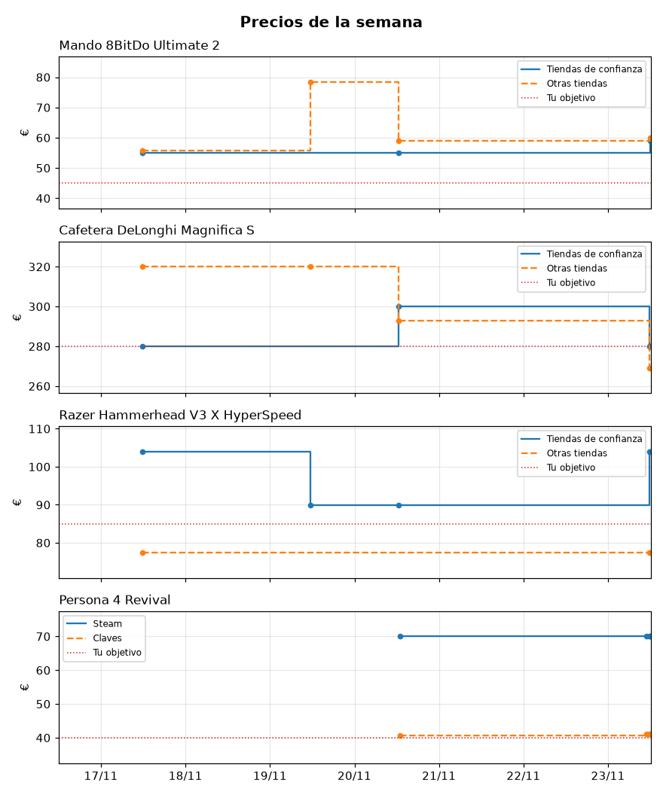
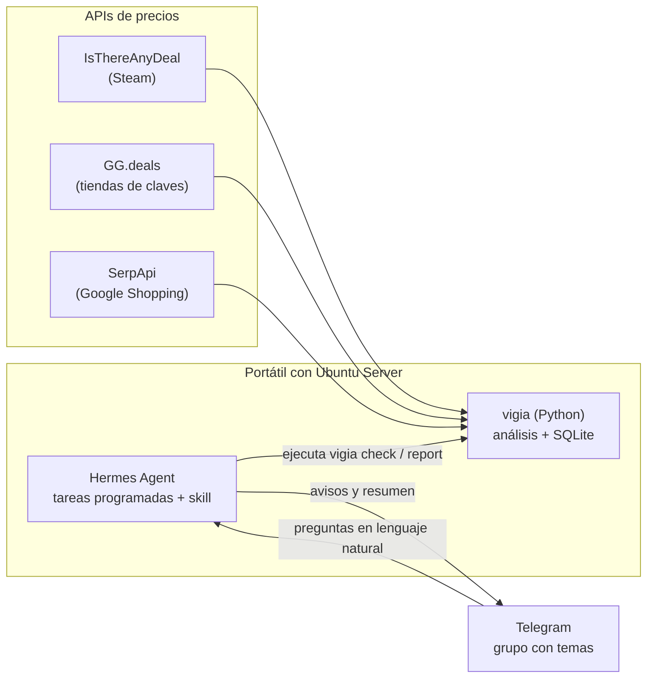

# 🛰️ Vigía de precios

[](https://github.com/Miguelesmi18/vigia-precios/actions/workflows/tests.yml)


**Agente personal que vigila precios de juegos y productos, detecta ofertas falsas y me avisa por Telegram.**
Funciona 24 h en un portátil reciclado con Ubuntu Server y lo controla un agente de IA ([Hermes Agent](https://hermes-agent.nousresearch.com), de Nous Research).

<p align="center">
  
  &nbsp;&nbsp;
  
</p>

## Qué hace

| Función | Detalle |
|---|---|
| 🔔 **Avisos al momento** | Cuando algo baja de mi precio objetivo en una tienda de confianza. Solo avisa de ofertas **nuevas**, sin repetir. |
| 🕵️ **Detector de ofertas falsas** | Compara con el historial: regla europea de los 30 días (Omnibus), precio inflado antes de la rebaja y mínimo histórico. |
| 🏬 **Confianza de cada tienda** | Distingue tienda oficial, tienda de confianza, marketplace con vendedores externos y tiendas extranjeras (aduanas y garantía). |
| 🚩 **Precios sospechosos** | Marca ofertas por debajo de la mitad del precio normal y descarta accesorios, segunda mano y modelos parecidos. |
| 📊 **Resumen semanal** | Cada lunes: semáforo por producto, tendencia, consejo de compra, cuenta atrás al Black Friday, presupuesto de Navidad y gráfica. |
| 🖥️ **Vigilancia del servidor** | Temperatura y batería del portátil, con aviso si se desenchufa. |

Ejemplo de aviso:

```
🔔 Cafetera DeLonghi Magnifica S: 279,90 € en delonghi.es (objetivo 280,00 €)
🔎 Razer Hammerhead V3 X: 77,44 € en Play-Asia.com [extranjera: revisa envío, aduanas y garantía]
```

## Cómo funciona



### Qué hace Hermes y qué hace mi código

| Hermes Agent (IA) | Mi código en Python |
|---|---|
| Programa las tareas: avisos 4 veces al día, resumen los lunes, batería cada 10 min | Consulta las APIs y guarda el historial en SQLite |
| Envía los mensajes y la gráfica a cada tema del grupo de Telegram | Detecta ofertas falsas y clasifica las tiendas |
| Responde preguntas ("¿cómo va la cafetera?") con una *skill* propia que usa `vigia` | Genera el resumen, la gráfica (matplotlib) y los avisos |
| Modelo: Gemini (Google AI Studio) | 69 tests con pytest e integración continua en GitHub Actions |

Las tareas automáticas no gastan IA: Hermes ejecuta los scripts directamente (modo *no-agent*). El modelo solo se usa cuando le hablo.

## Tecnologías

`Python 3.12` · `SQLite` · `requests` · `matplotlib` · `pytest` · `GitHub Actions` · `Hermes Agent` · `Gemini` · `Telegram` · `Ubuntu Server` · `systemd` · `SSH` · `ufw`

## Instalación

```bash
git clone https://github.com/Miguelesmi18/vigia-precios.git
cd vigia-precios
python3 -m venv .venv
source .venv/bin/activate          # Windows: .\.venv\Scripts\Activate.ps1
pip install -e ".[dev]"
pytest -q
```

### Claves de API

Copia `.env.example` a `.env` y rellena tus claves. El `.env` está en `.gitignore`: **nunca se sube a GitHub**.

| Variable | Para qué | Plan gratuito |
|---|---|---|
| `ITAD_API_KEY` | Precios de Steam | Sí |
| `GGDEALS_API_KEY` | Tiendas de claves | Sí |
| `SERPAPI_KEY` | Productos físicos (Google Shopping) | 250 búsquedas/mes |
| `CHRISTMAS_BUDGET` | Presupuesto de Navidad (opcional) | — |

## Uso

```bash
vigia add "Persona 4 Revival" 40                                   # vigilar un juego
vigia add-product "Cafetera DeLonghi" 280 --model "ECAM22.110"     # vigilar un producto
vigia list                                                         # qué vigilo
vigia check                                                        # comprobar precios ahora
vigia report --chart                                               # resumen + gráfica
```

### Automatizar con Hermes

```bash
hermes cron create "0 9,13,17,21 * * *" --no-agent --script vigia-check.sh \
  --deliver telegram:<grupo>:<tema> --name vigia-avisos
```

## Estructura

```
src/vigia/
├── cli.py        # comandos de la terminal
├── db.py         # SQLite: productos, historial de precios y avisos enviados
├── itad.py       # cliente de IsThereAnyDeal (Steam)
├── ggdeals.py    # cliente de GG.deals (tiendas de claves)
├── serpapi.py    # cliente de Google Shopping vía SerpApi
├── analysis.py   # detector de ofertas falsas
├── stores.py     # confianza de cada tienda
├── report.py     # resumen semanal
└── charts.py     # gráfica PNG
tests/            # 69 tests, sin conexión a internet (clientes falsos)
```

## Uso responsable

Solo uso **APIs oficiales**: no hay *scraping* ni se saltan protecciones de ninguna web. Si una tienda no ofrece una forma legal de consultarla, no se consulta.

## Autor

**Miguel Martínez Costa**: estudiante de 2.º de DAM en Barcelona.
[LinkedIn](https://linkedin.com/in/miguel-martinez-costa-6265662ba) · [GitHub](https://github.com/Miguelesmi18)
